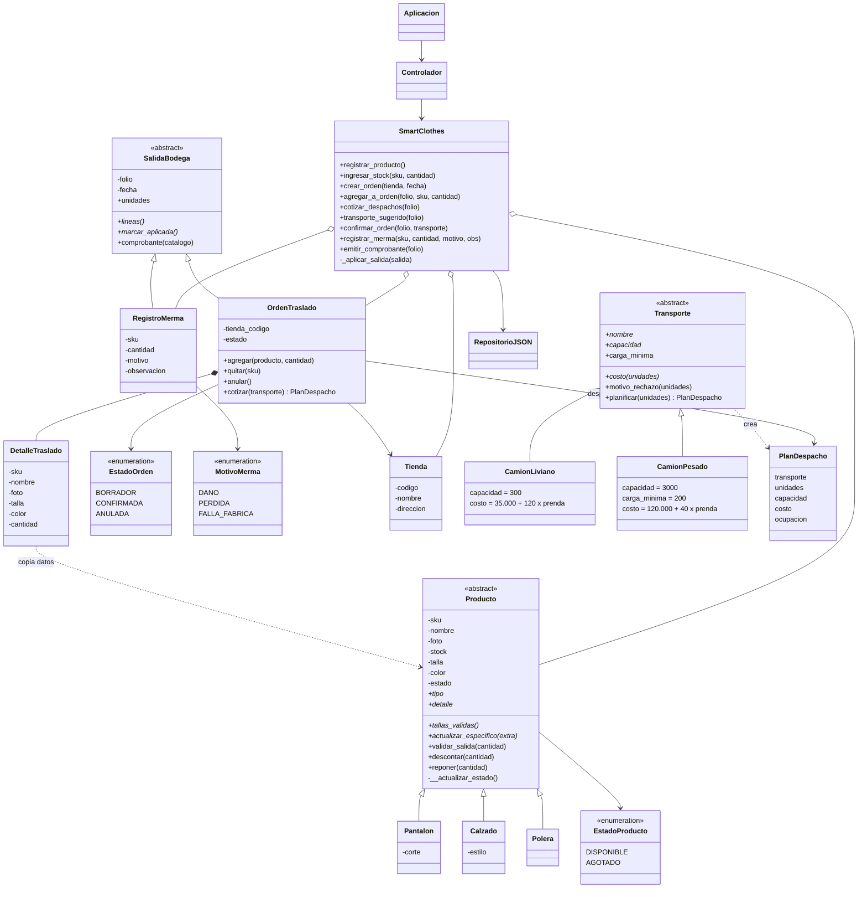

# Diagrama de clases

`SmartClothes.confirmar_orden` recibe cualquier `Transporte` y la orden llama a `planificar()`. Cada camión responde con su propia capacidad, carga mínima y tarifa. Agregar un furgón, por ejemplo, es crear `class Furgon(Transporte)` y sumarlo a `TRANSPORTES`, sin modificar `OrdenTraslado` ni `SmartClothes`.

`SmartClothes._aplicar_salida` recibe cualquier `SalidaBodega`: recorre `lineas()`, valida y descuenta con `Producto.descontar()`, y luego llama a `marcar_aplicada()`. No tiene una rama para traslados y otra para mermas. Para sumar un nuevo tipo de salida (por ejemplo, una devolución a proveedor) basta con crear otra subclase.
